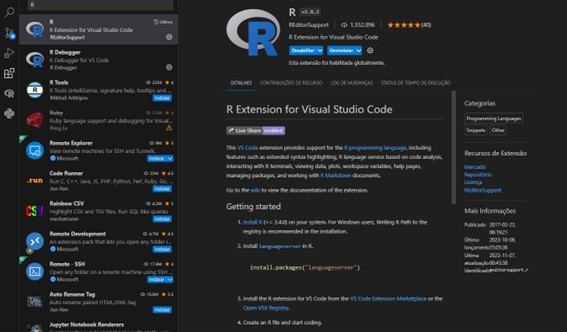
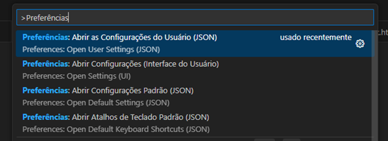
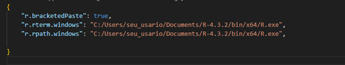
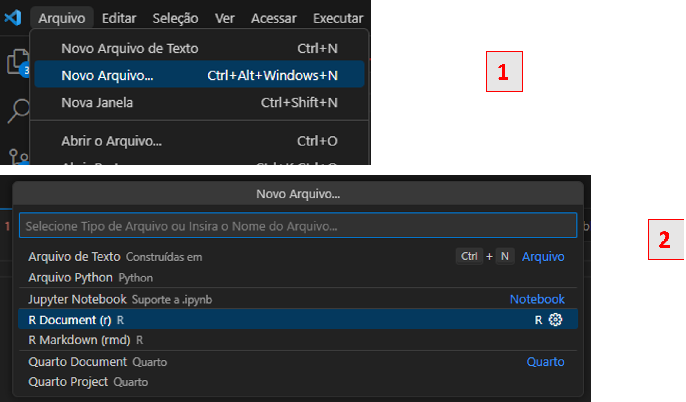

## Objetivo

O objetivo deste post é auxiliar na instalação e configuração do ambiente de desenvolvimento R utilizando o VS Code.

## Primeiros passos

É notável que atualmente existem inúmeros benefícios para a utilização da IDE [RStudio](https://posit.co/download/rstudio-desktop/), porém, existem gargalos na sua utilização que podem comprometer a produtividade no dia a dia. Em 2023, o Stack Overflow lançou uma [pesquisa](https://survey.stackoverflow.co/2023/#worked-with-vs-want-to-work-with-new-collab-tools-worked-want) e constatou que 73,71% dos programadores tinham o VS Code como IDE preferido e apenas 2,71% o RStudio. Portanto, esse fato revela não apenas a popularidade, mas também uma série de benefícios e facilidades na utilização dessa IDE.

Para programar em R no VS Code, siga estes passos iniciais:

1. Baixar o interpretador R via [CRAN](https://cran.r-project.org/);
2. Realizar a instalação e localizar o referido caminho. É indicado que seja sempre instalado em uma pasta que não necessite de permissão de administrador para modificação ou instalação de pacotes (por exemplo, `C:\Users\seu_usuario\Documents\R-4.3.2`);
3. Abrir o R via terminal (`C:\Users\seu_usuario\Documents\R-4.3.2\bin\x64\R.exe`) e instalar o pacote de suporte à linguagem:
   - Execute `install.packages("languageserver")`. Nessa etapa será solicitado selecionar o espelho do CRAN para baixar os pacotes (recomenda-se escolher a opção mais próxima de sua região);
4. Instalar o [VS Code](https://code.visualstudio.com/);
5. Abrir o VS Code e instalar a extensão oficial para o [R](https://marketplace.visualstudio.com/items?itemName=REditorSupport.r):
   - Use o atalho **Ctrl + Shift + X** e pesquise pela extensão **R**:

   

6. Posteriormente, configure os caminhos editando o arquivo de configurações (`settings.json`):
   - Use o atalho **Ctrl + Shift + P**, digite `"Preferences: Open User Settings (JSON)"` na barra de pesquisa, edite o arquivo conforme as imagens abaixo, salve e feche:

   

   

7. Pronto! Se tudo estiver configurado conforme os passos acima, o `R` já estará pronto para ser aberto no terminal. Para isso, basta clicar em **Arquivo** (ou abrir a paleta de comandos) e iniciar um novo terminal R:

   

A partir de agora é só executar algum código (experimente `print("Olá, mundo!")`) e o console do R abrirá automaticamente. Praticamente tudo o que um usuário de R realiza com o RStudio pode ser realizado com o VS Code. Existem outras maneiras a serem exploradas na integração entre R e VS Code, como utilizar o [radian](https://github.com/randy3k/radian) como terminal interativo para executar os códigos em R, sendo a abordagem apresentada neste tutorial a maneira mais simples e direta para a configuração inicial.

## Configurações adicionais

Recomenda-se instalar também os pacotes `languageserver` e `httpgd` para melhor visualização interativa de gráficos dentro do VS Code.

## Conclusão

Este post buscou introduzir e exemplificar o procedimento para a instalação e configuração básica do R no VS Code.
